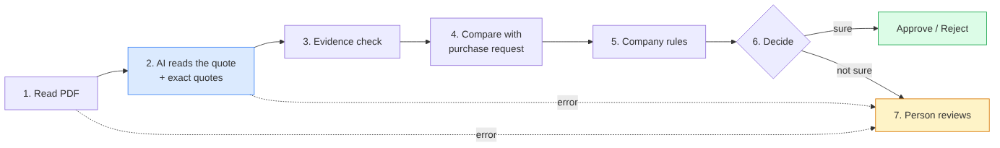
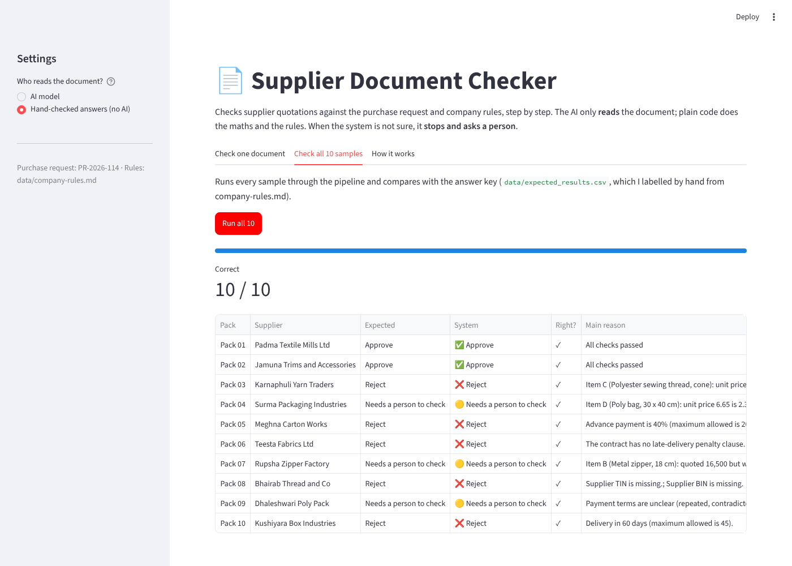

# quote-checker-langgraph

An AI system that checks supplier quotations and gives one of three answers for each: **Approve**, **Reject**, or **Needs a person to check**, with the reason and the exact text from the document.

It is built as **fixed steps that always run in the same order** (LangGraph), not as a free-running agent. The AI does one job only: it **reads** the document. Plain Python does all the maths and applies the rules. When the system is not sure, it **stops and asks a person**.



## Demo



## How it works

| Step | What happens | Uses AI? |
|---|---|---|
| 1. Read PDF | Turn the PDF into text. No text (e.g. a scan) → send to a person. | No |
| 2. Read the quote | The AI fills a fixed form (supplier, items, qty, prices, VAT, TIN/BIN, payment, delivery, penalty, validity). **For every value it must copy the exact words it read it from.** | **Yes** |
| 3. Evidence check | Is each quote really in the document? Is the number really inside the quote? If the AI says the TIN or penalty clause is missing, the code searches the document itself. | No |
| 4. Compare with purchase request | Quantity (±5%) and unit price (vs. the maximum). | No |
| 5. Company rules | Advance, payment days, penalty, TIN/BIN, delivery days, VAT, arithmetic, validity. | No |
| 6. Decide | Any Reject rule → **Reject**. Otherwise any review rule → **Needs a person**. Otherwise **Approve**. | No |
| 7. Person reviews | For "Needs a person", the pipeline pauses (LangGraph `interrupt`) until someone clicks Approve or Reject. | No |

Two safety rules:
- **Only reject on proof.** If a rejection depends on a value whose evidence could not be confirmed, it becomes "Needs a person" instead.
- **Any error goes to a person.** Unreadable PDF, AI timeout, AI returns bad data (after one retry), unknown item: none of these produce a guess.

## Run it

Needs Python 3.10+.

```bash
pip install -r requirements.txt
```

Get a free key from [Groq](https://console.groq.com/keys) (default) or [Google AI Studio](https://aistudio.google.com/apikey). Any OpenAI-compatible API works, including a local model through [Ollama](https://ollama.com) for fully offline use. See `.env.example`.

```bash
streamlit run app.py          # web demo
python run.py                 # check all 10 samples with the AI and print the score
python run.py --offline       # same, without AI (uses the hand-checked readings)
pytest -q                     # 34 tests, no API key needed
```

## Results on the 10 sample packs

The answer key (`data/expected_results.csv`) is made from the reading of `company-rules.md`

| Pack | Supplier | Expected | Main reason |
|---|---|---|---|
| 01 | Padma Textile Mills | Approve | All rules pass |
| 02 | Jamuna Trims | Approve | All rules pass |
| 03 | Karnaphuli Yarn | Reject | Price 9.05% above maximum |
| 04 | Surma Packaging | Needs a person | Price 2.31% above maximum (within 3%) |
| 05 | Meghna Carton | Reject | 40% advance; payment clause repeated |
| 06 | Teesta Fabrics | Reject | No late-delivery penalty clause |
| 07 | Rupsha Zipper | Needs a person | Quantity 16,500 vs 20,000 (−17.5%) |
| 08 | Bhairab Thread | Reject | TIN and BIN missing |
| 09 | Dhaleshwari Poly | Needs a person | 50,000 × 6.40 ≠ 322,000; payment "30 to 90 days as agreed" |
| 10 | Kushiyara Box | Reject | Delivery 60 days; VAT not shown separately |

- **Rules + evidence check (hand-checked readings):** 10 / 10 correct.
- **Full system with AI (`openai/gpt-oss-120b` on Groq):** see `results/results-ai.json` after running `python run.py`. It also reports how many fields the AI read correctly, compared with the hand-checked readings in `tests/golden/`.


## Project layout

```
app.py                 Streamlit demo
run.py                 Batch run + score + AI reading accuracy
checker/
  graph.py             The LangGraph pipeline (the fixed steps)
  pdf_reader.py        Step 1
  extractor.py         Step 2: the only AI call, plus the prompt
  verify.py            Step 3: evidence check
  rules.py             Steps 4–6: purchase request, company rules, decision
  schema.py            The form the AI must fill
data/                  BIAI sample files + my answer key
tests/                 Tests + hand-checked readings (golden/)
```
